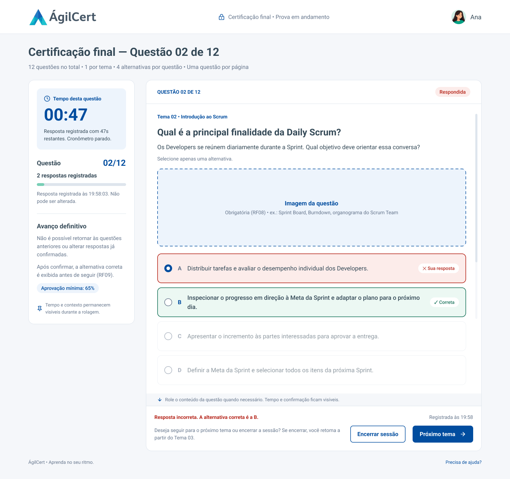
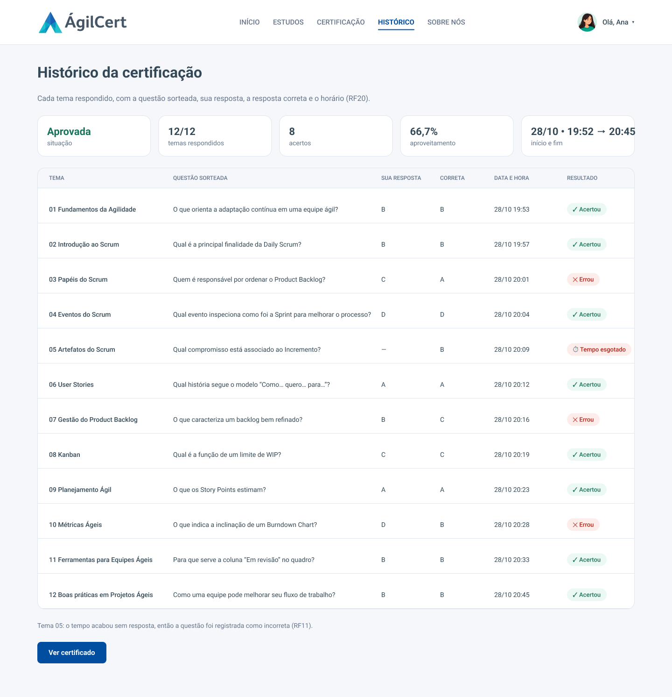

# Design — Protótipo ÁgilCert

Protótipo navegável do Portal de Certificação em Metodologias Ágeis. Ele consolida as telas desenhadas pela equipe com os ajustes necessários para atender ao [documento de requisitos](../requisitos/Desafio%201DSM%20-%202026-2.pdf).

**Figma:** [ÁgilCert v2 — Protótipo navegável](https://www.figma.com/design/SwcF0Sngo2feMs0szTAkwC/ABP_ctrl_alt_devs?node-id=737-1307)

Para navegar, abra a página no Figma, clique em **▶ Present** e escolha o fluxo **Fluxo do candidato**, que começa no Login.

Ao lado de cada tela, no Figma, há um card com os requisitos atendidos, as regras, a API usada, os estados de erro e a navegação.

## Decisões de design

| Decisão | Requisito |
|---|---|
| Login apenas com CPF e senha | RF04 |
| A certificação pode ser iniciada a qualquer momento; estudar os temas é recomendado, não obrigatório | RF02 |
| Cada candidato tem uma única tentativa | RF15 |
| A alternativa correta aparece logo após cada resposta | RF09 |
| Tempo esgotado ou saída durante a questão: questão encerrada e contada como incorreta, com a correta exibida | RF11, RF14 |
| Após cada resposta, o candidato escolhe entre seguir para o próximo tema ou encerrar a sessão | RF12 |
| Toda questão tem imagem e quatro alternativas | RF08 |
| A validação do certificado é pública e mostra o CPF mascarado | RF19, RNF03 |

## Telas

Legenda de status: **mantida** (tela original sem mudanças), **ajustada** (tela original com correções), **refeita** (tela antiga redesenhada no padrão visual atual), **nova** (tela que não existia).

### 1. Acesso

| Tela | Status | Requisitos |
|---|---|---|
| [1.1 Login](telas/desktop/1.1-login.png) | refeita | RF04 |
| [1.2 Cadastro](telas/desktop/1.2-cadastro.png) | refeita | RF03, RNF03 |
| [1.3 Início](telas/desktop/1.3-inicio.png) | refeita | RF01, RF02 |

### 2. Estudos

| Tela | Status | Requisitos |
|---|---|---|
| [2.1 Área de estudos](telas/desktop/2.1-area-de-estudos.png) | ajustada | RF07, RF21, RP07 |
| [2.2 Tema 02 — leitura retomada](telas/desktop/2.2-tema-02-leitura-retomada.png) | mantida | RF07 |
| [2.3 Tema 02 — último bloco](telas/desktop/2.3-tema-02-ultimo-bloco.png) | mantida | RF07, RF21 |
| [2.4 Tema 03 — primeiro bloco](telas/desktop/2.4-tema-03-primeiro-bloco.png) | mantida | RF07 |
| [2.5 Tema 12 — último bloco](telas/desktop/2.5-tema-12-ultimo-bloco.png) | mantida | RF07, RF21 |

### 3. Certificação

| Tela | Status | Requisitos |
|---|---|---|
| [3.1 Instruções da certificação](telas/desktop/3.1-instrucoes-da-certificacao.png) | ajustada | RF01, RF02, RF05, RF10 |
| [3.2 Questão — sem resposta](telas/desktop/3.2-questao-01-sem-resposta.png) | ajustada | RF05, RF06, RF08, RF10 |
| [3.3 Questão — tempo esgotado](telas/desktop/3.3-questao-01-tempo-esgotado.png) | nova | RF11, RF12, RF14 |
| [3.4 Questão — alternativa selecionada](telas/desktop/3.4-questao-02-alternativa-selecionada.png) | ajustada | RF08, RF10, RF15 |
| [3.5 Questão — resposta correta](telas/desktop/3.5-questao-02-resposta-correta.png) | nova | RF09, RF12, RF20 |
| [3.6 Questão — resposta incorreta](telas/desktop/3.6-questao-02-resposta-incorreta.png) | nova | RF09, RF12 |
| [3.7 Retomar certificação](telas/desktop/3.7-retomar-certificacao.png) | nova | RF13, RF14, RF21 |
| [3.8 Questão — última](telas/desktop/3.8-questao-12-ultima.png) | ajustada | RF05, RF16 |

### 4. Resultado e certificado

| Tela | Status | Requisitos |
|---|---|---|
| [4.1 Resultado — aprovado](telas/desktop/4.1-resultado-aprovado.png) | mantida | RF16, RF17 |
| [4.2 Resultado — não aprovado](telas/desktop/4.2-resultado-nao-aprovado.png) | nova | RF17, RF20 |
| [4.3 Certificado](telas/desktop/4.3-certificado.png) | ajustada | RF18, RP08 |
| [4.4 Validação pública do certificado](telas/desktop/4.4-validacao-publica-do-certificado.png) | nova | RF19, RP08, RNF03 |

### 5. Conta

| Tela | Status | Requisitos |
|---|---|---|
| [5.1 Histórico](telas/desktop/5.1-historico.png) | nova | RF20, RF21 |
| [5.2 Perfil](telas/desktop/5.2-perfil.png) | refeita | RNF03 |

### Destaques

  
  

## Design system

| Token | Valor | Uso |
|---|---|---|
| `--color-primary` | `#014D9F` | Botões, links, títulos de destaque |
| `--color-primary-soft` | `#EDF4FC` | Fundo de item selecionado e de destaques |
| `--color-text` | `#344957` | Texto principal |
| `--color-text-secondary` | `#64748B` | Textos de apoio, rótulos |
| `--color-bg` | `#F5F7FA` | Fundo das páginas |
| `--color-card` | `#FFFFFF` | Cards |
| `--color-border` | `#DEE5ED` | Bordas e divisores |
| `--color-success` / `--color-success-bg` | `#19735B` / `#ECF8F3` | Acerto, concluído, aprovado |
| `--color-error` / `--color-error-bg` | `#B42318` / `#FDECEA` | Erro, tempo esgotado (proposta, ainda não aprovada) |

- **Fonte:** Roboto (Regular, Medium e Bold).
- **Raios:** 8 px em botões e campos, 12 px em alternativas, 16 px em cards e 100 px em selos.
- **Sombra dos cards:** `0 8px 24px rgba(35, 63, 87, .06)`.

## Pendências

- Versão mobile (RNF01): a página mobile do Figma ainda segue a primeira versão do design e será documentada quando estiver no padrão destas telas.
- Substituir os marcadores de imagem das questões pelas imagens reais (RF08).
- Revisar os textos com a equipe e o Product Owner.

## Como atualizar as imagens

1. No Figma, selecione as telas na página "ÁgilCert v2 — Protótipo navegável".
2. No painel **Export**, exporte em PNG 1x.
3. Salve em `telas/desktop`, mantendo os nomes de arquivo desta página.

[Voltar à documentação geral](../README.md)
