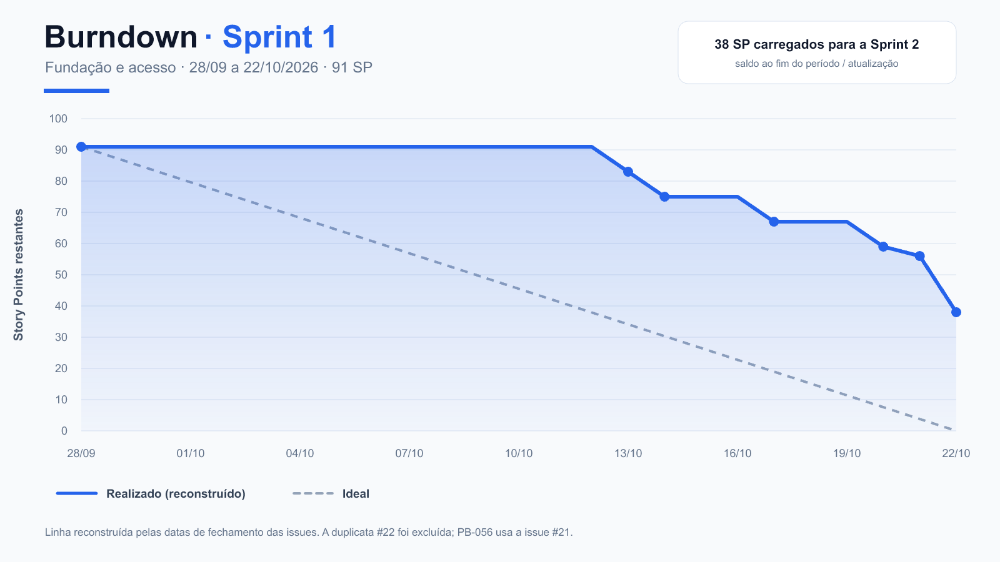

# Burndown — Sprint 1

**Período oficial:** 28/09/2026 a 22/10/2026
**Escopo original:** 25 PBIs e 91 Story Points
**Resultado no encerramento:** 38 SP carregados para a Sprint 2

## Método

O repositório não mantém uma captura diária imutável do campo Status do GitHub
Projects. Por isso, a linha realizada foi **reconstruída** com os Story Points
do planejamento e a data de fechamento das issues no GitHub. Uma issue reduz o
saldo ao fim do dia em que foi fechada.

A issue #22 repete o identificador PB-056. Para preservar os 25 PBIs e 91 SP do
planejamento original, o cálculo usa a issue oficial #21 para PB-056 e exclui a
duplicata #22.

## Pontos de mudança

| Data | SP restantes | Observação |
|---|---:|---|
| 28/09 | 91 | Início da Sprint |
| 13/10 | 83 | Primeiros fechamentos registrados |
| 14/10 | 75 | Avanço em fundação, conteúdo e documentação |
| 17/10 | 67 | Infraestrutura e estratégia Git |
| 20/10 | 59 | Docker, CPF e login |
| 21/10 | 56 | Cadastro concluído |
| 22/10 | 38 | Encerramento oficial; seis PBIs carregados |

## Débito carregado

| PBI | Issue | SP |
|---|---:|---:|
| PB-006 | #7 | 3 |
| PB-016 | #17 | 3 |
| PB-017 | #18 | 3 |
| PB-018 | #19 | 3 |
| PB-053 | #20 | 13 |
| PB-056 | #21 | 13 |
| **Total** | — | **38** |

Esses itens foram concluídos e fechados em 05/11/2026, durante a Sprint 2.

**Fontes:** planejamento da Sprint 1, issues do milestone Sprint 1 e datas de
fechamento consultadas no GitHub em 06/11/2026.
