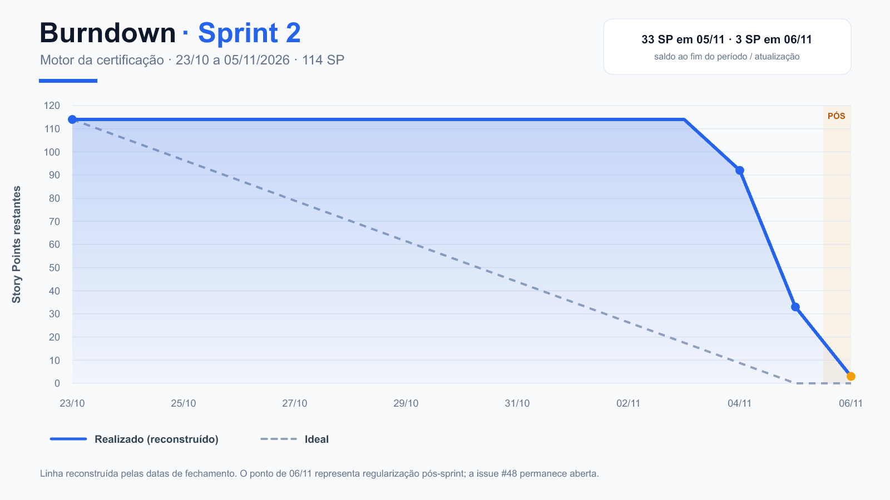

# Burndown — Sprint 2

**Período oficial:** 23/10/2026 a 05/11/2026
**Escopo original:** 28 PBIs e 114 Story Points
**Resultado no encerramento:** 33 SP pendentes
**Situação em 06/11/2026:** 3 SP pendentes na issue #48

## Método

Como o repositório não preserva uma captura diária imutável do GitHub Projects,
a linha realizada foi **reconstruída** usando os Story Points originais e as
datas de fechamento das issues. A linha ideal chega a zero em 05/11. O ponto de
06/11 é exibido como pós-sprint para tornar visível a regularização do débito.

Os 38 SP herdados da Sprint 1 foram executados durante o período, mas não foram
somados à base de 114 SP do gráfico para não alterar retroativamente o
compromisso original da Sprint 2.

## Pontos de mudança

| Data | SP restantes | Observação |
|---|---:|---|
| 23/10 | 114 | Início da Sprint |
| 04/11 | 92 | Histórico, respostas, data/hora e imagens fechados |
| 05/11 | 33 | Encerramento oficial; 20 PBIs fechados e 8 pendentes |
| 06/11 | 3 | Sete débitos finalizados após a Sprint |

## Saldo do encerramento oficial

| Issues | SP em 05/11 | Situação em 06/11 |
|---|---:|---|
| #46, #47, #49, #50, #57, #58 e #59 | 30 | Fechadas como concluídas |
| #48 — PB-027 | 3 | Aberta como dívida técnica |
| **Total** | **33** | **3 SP restantes** |

A issue #48 permanece atribuída a `isabella0andreotti`, `AlvesRogiel` e
`JulioCesarP95`.

**Fontes:** refinamento das três sprints, milestone Sprint 2, Story Points e
datas de fechamento consultadas no GitHub em 06/11/2026.
